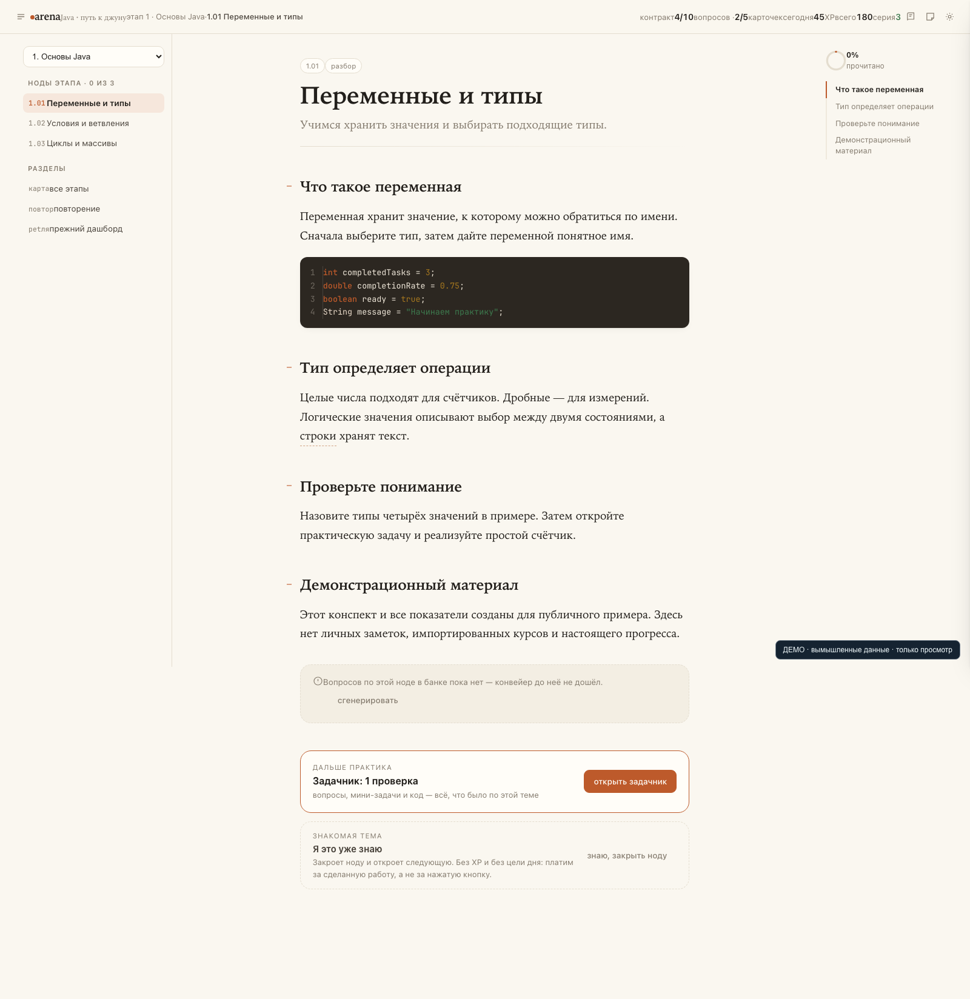
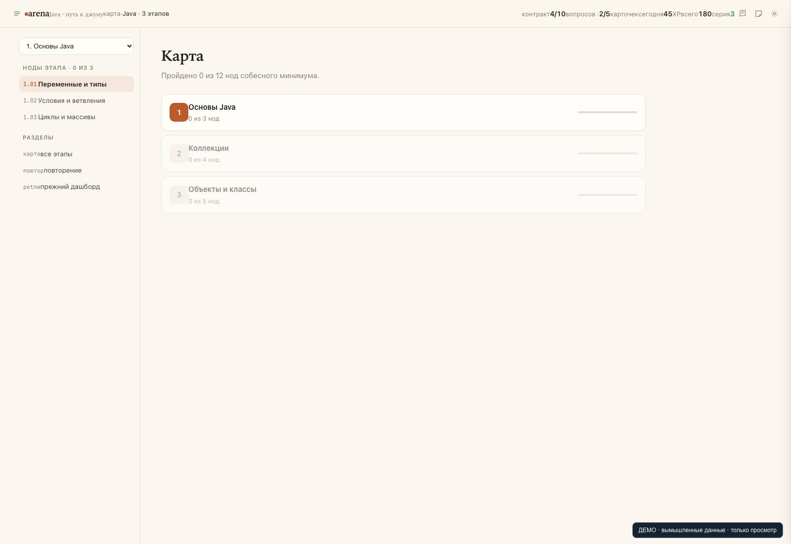
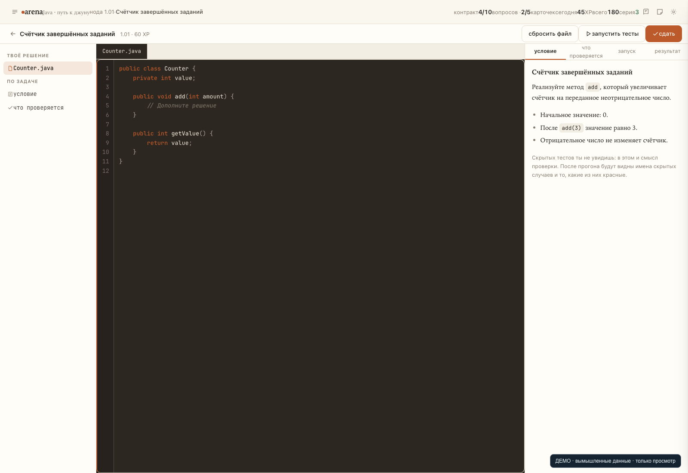

# arena

Учебный тренажёр Java и SQL: конспекты, карта тем, интервальное повторение, задачи в браузерной IDE, боссы этапов, опыт и сезоны. Python, FastAPI и обычный JavaScript.

Это публичная версия с чистой историей. Личные заметки, импортированные курсы, учебная база, прогресс, портфель решений, рабочие конфиги и сведения о клиентах исключены. Промпты обезличены; подключение моделей настраивается локально.

## Интерфейс

Все материалы и показатели на изображениях вымышленные.



| Карта тем | Браузерная IDE |
| --- | --- |
|  |  |

## Демонстрация

```bash
python3 tools/demo.py
```

Откройте напечатанный адрес. Скрипт выбирает новый свободный порт localhost, читает только статические файлы и выдаёт вымышленные ответы API. Базы, личные файлы, AI, Java и SQL не запускаются; запросы изменения возвращают HTTP 405. Ctrl+C останавливает этот отдельный сервер.

## Собственная установка

```bash
python3 -m venv .venv
.venv/bin/python -m pip install -r requirements.txt
python3 -m arena --help
```

По умолчанию выбран профиль `dev`, запись в Obsidian выключена. Для своего контента задайте `ARENA_VAULT`, `ARENA_ROADMAP_DIR`, `ARENA_STATE_DIR`, `ARENA_TASKS_ROOT` и `ARENA_RUNS_ROOT` локально. Затем используйте команды `sync`, `import`, `stats` и `serve`. Генерация контента требует отдельно настроенного CLI/API-провайдера; учебные прогоны Java требуют JDK и локальной JUnit-библиотеки `vendor/junit-platform-console-standalone.jar`. Двоичные зависимости и исходные импорты в эту публикацию не включены.

В `arena/` находятся ядро прогресса, сервер, генераторы и импортёры; в `static/` — интерфейсы; в `prompts/` и `content/` — общие шаблоны и примеры. Сценарии в `scripts/` проверяют отдельные этапы разработки и требуют собственного изолированного учебного окружения.

## Локальные секреты

[Шифрование локальных файлов и проверка публикации](documentation/SECURITY.md). Пароль вводится только в терминале; исходные и зашифрованные конфиги игнорируются Git. Рабочие настройки других установленных копий проект не меняет.
